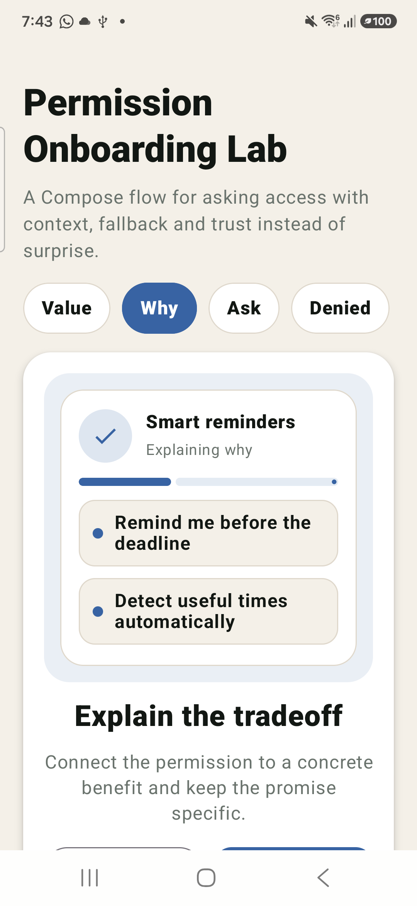

> **Ce lab a déménagé.** Il fait maintenant partie de [mobile-ui-labs](https://github.com/YANKAMKEVIN/mobile-ui-labs), qui réunit les 10 labs dans une seule app. Ce dépôt est archivé.

# Permission Onboarding Lab

Mini-projet Android/KMP pour explorer l'onboarding autour des permissions dans une UI Compose.

Le but n'est pas de livrer une app complete, mais de montrer comment demander une permission sans casser la confiance :

- valeur avant permission ;
- rationale ;
- demande systeme simulee ;
- denied state ;
- limited/granted state.

## Pourquoi ce mini-projet ?

Une permission n'est pas une formalite technique. C'est un moment de confiance :

- l'utilisateur comprend-il la valeur avant la demande ?
- le texte explique-t-il le besoin sans manipuler ?
- que se passe-t-il si l'utilisateur refuse ?
- peut-il continuer avec une experience limitee ?

Le flow est interactif pour comparer les etats before ask, rationale, denied, limited et granted.

## Stack

- Kotlin Multiplatform
- Compose Multiplatform
- Material 3
- Android target pret a lancer

## Screenshots

<p align="center">
  
</p>

## Idee de post LinkedIn

> Une permission Android ne devrait pas arriver comme une surprise.
>
> Dans ce mini-projet Compose/KMP, j'explore un flow de demande permission : valeur, rationale, refus, acces limite et succes.
>
> La question interessante : comment demander l'acces sans casser la confiance ?

## Run

```bash
./gradlew :composeApp:assembleDebug
```
